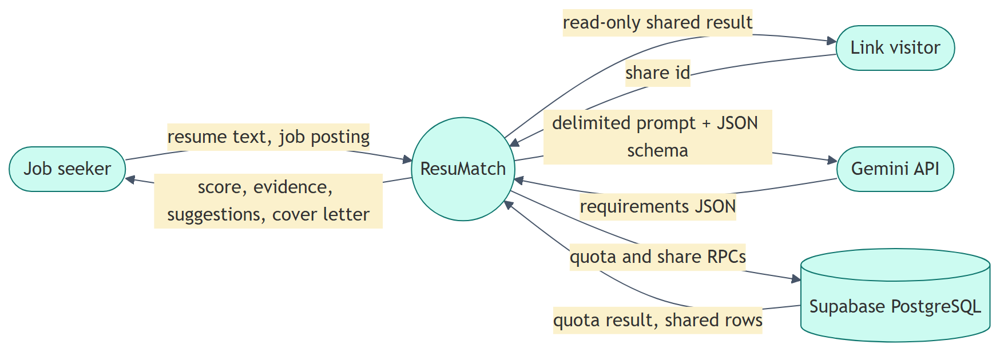
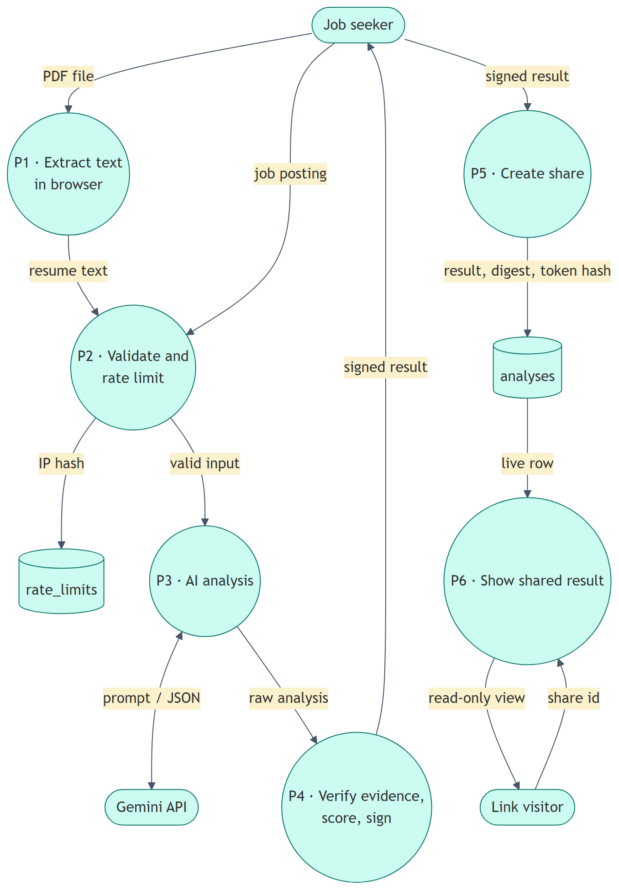
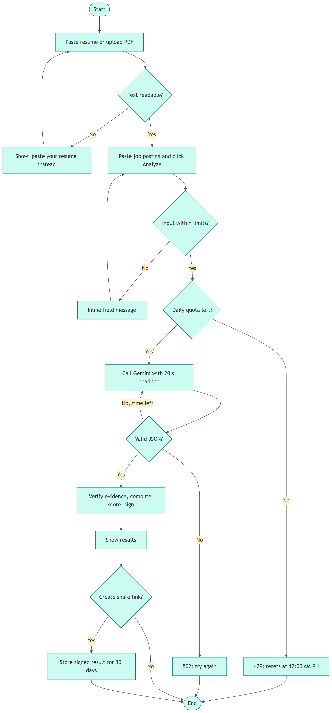

# ResuMatch

**AI Resume & Job Matcher**

ResuMatch compares a resume with a job posting and gives an honest match analysis. It shows which requirements you meet, with quotes from your own resume as evidence, concrete suggestions, and a cover letter draft that only uses facts from your resume. It is built for fresh graduates and job seekers in the Philippines.

[](https://github.com/jomari18/resumatch/actions/workflows/ci.yml)

## Live Demo

**[Open ResuMatch](https://resumatch-ph.netlify.app)**

## Highlights

- Resume input by PDF upload or pasted text. The PDF is read in the browser and never uploaded.
- AI analysis through a provider-agnostic `AIProvider` interface. Gemini is the first provider.
- The score is **computed by code** from the requirement list, not guessed by the AI: required counts double, partial gets half credit.
- **Evidence verification:** every matched requirement must quote the resume word for word. Quotes that cannot be found are downgraded and flagged.
- Duplicate skills from the AI are merged before scoring.
- Optional share links that expire after 30 days. The owner can delete a link from the same browser.
- Per-IP (10 per day) and site-wide daily limits, enforced atomically in PostgreSQL.
- A light 3D match orb (React Three Fiber) that falls back to a static SVG under reduced motion or without WebGL.
- Responsive from 360 px to 1440 px, with light and dark mode and keyboard-accessible tabs.

## System design

| Context diagram | Data flow diagram |
|---|---|
|  |  |



The full design is in [docs/superpowers/specs/2026-10-19-resumatch-design.md](docs/superpowers/specs/2026-10-19-resumatch-design.md).

## Tech Stack

- Next.js 16 (App Router), React 19, TypeScript (strict)
- Tailwind CSS v4
- React Three Fiber and drei
- pdf.js (`pdfjs-dist`)
- zod
- Google Gen AI SDK (Gemini)
- Supabase (PostgreSQL), accessed only from the server
- Vitest, Testing Library, Playwright
- GitHub Actions
- Netlify

## Security Design

- **Secrets stay on the server.** The Gemini key, the Supabase secret key, the IP salt and the signing secret are read only in server modules guarded by `server-only`.
- **The database is locked down.** RLS is on with no policies for `anon` or `authenticated`, table privileges are revoked, and the RPC functions can be executed only by `service_role`.
- **Resume text is never stored or logged.** Logs contain only a request id, the outcome code and the duration.
- **Only real analyses can be shared.** Shared results are HMAC-signed by the server, so the site cannot be used to host arbitrary text.
- **Share links are private.** Ids are 12 random URL-safe characters. Share pages are `noindex`. The delete token is sent as a bearer header and stored only as a SHA-256 hash.
- **Prompt injection is contained.** Inputs are delimited data, closing tags are neutralized, output is constrained by a JSON schema and validated with zod, and the score never comes from the model.
- **Security headers.** A nonce-based Content Security Policy, `frame-ancestors 'none'`, `nosniff`, a strict referrer policy and a restrictive permissions policy.

> The Supabase project URL is not secret. The Supabase secret key, the Gemini API key and the two random secrets must never be committed to this repository.

## Database

Migrations live in [`supabase/migrations`](supabase/migrations):

- `analyses`: shared results only. It holds the result JSON, a digest for deduplication, the delete-token hash and the expiry time.
- `rate_limits`: daily counters per hashed IP, plus one site-wide row.
- `consume_quota`, `create_share`, `delete_share` and `cleanup_expired`: `security invoker`, a fixed `search_path`, and executable only by `service_role`.
- A daily `pg_cron` job removes expired shares and old counters at 3:00 AM Philippine time.

## Local Use

Requires Node.js 24.

```bash
npm ci
cp .env.example .env.local
npm run dev
```

For a fully local run without any keys, set these in `.env.local`:

- `AI_PROVIDER=fake`
- `STORE=memory`
- `IP_HASH_SALT` and `RESULT_SIGNING_SECRET`: any random strings of 32 or more characters

To use real services instead, set `GEMINI_API_KEY`, `SUPABASE_URL` and `SUPABASE_SECRET_KEY`. See `.env.example` for every variable.

## Testing

```bash
npm run lint
npm run typecheck
npm test
npm run test:db
npm run test:e2e
```

- `npm test`: unit, API and component tests (Vitest).
- `npm run test:db`: SQL tests against a disposable local PostgreSQL. On Windows, start it with `powershell -File tools/start-test-db.ps1`; it runs only on `127.0.0.1:55454`. CI uses a PostgreSQL 17 service container.
- `npm run test:e2e`: Playwright against a production build that uses the fake AI provider and the in-memory store. This includes PDF upload, scanned-PDF, rate-limit, share, offline, reduced-motion and keyboard-only tests.

## Author

**Jomari M. Candido**
Sole Software Developer · [Portfolio](https://jomaricandido.netlify.app) · [GitHub](https://github.com/jomari18)

## Project Status

Portfolio project, version 1.0. Results are guidance for job seekers, not a hiring decision.
